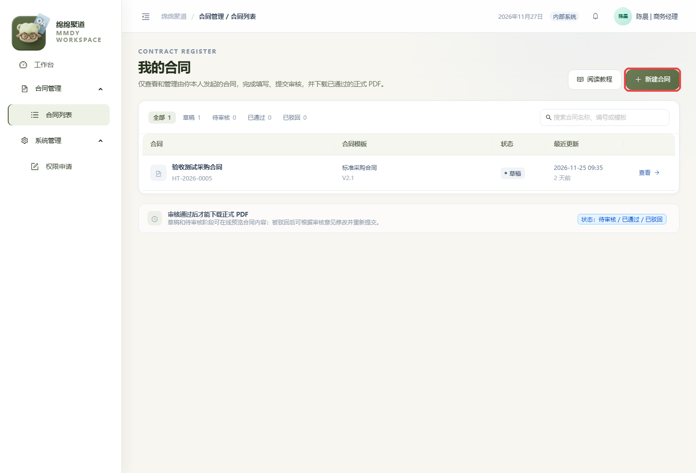
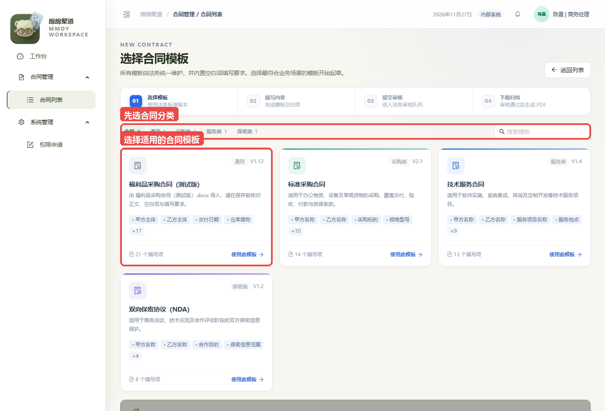
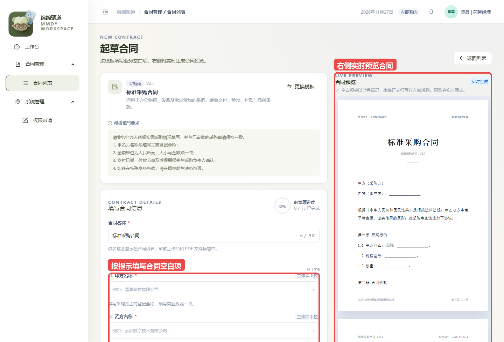
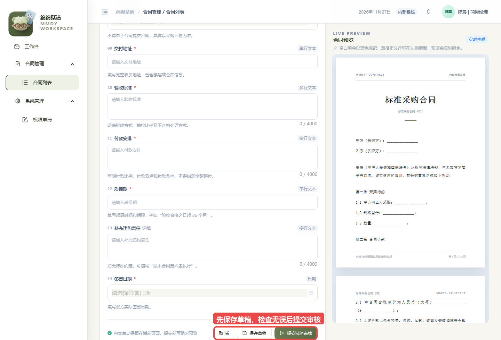
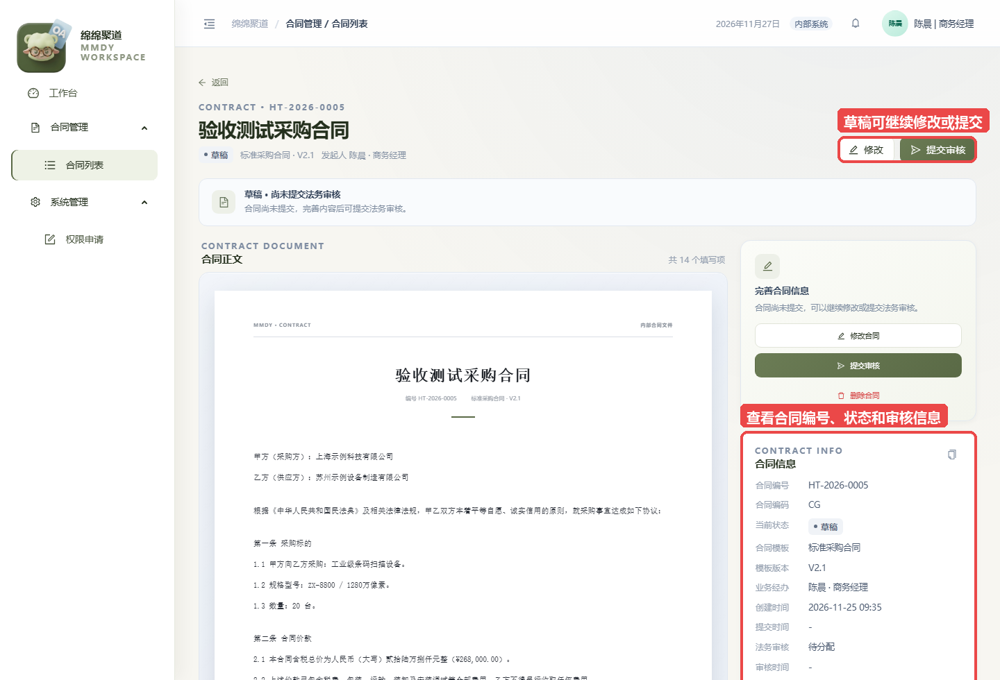

# 绵绵聚道 · 新建合同操作教程

> 适用对象：业务人员  
> 适用场景：使用法务维护的标准合同模板起草合同、保存草稿、提交审核并跟踪结果

## 一、流程总览

新建合同的完整流程如下：

1. 进入「合同管理 → 合同列表」；
2. 点击「新建合同」；
3. 选择合同模板；
4. 填写合同名称和正文要求的空白项；
5. 在右侧检查合同预览；
6. 保存草稿，或直接提交法务审核；
7. 在合同详情和列表中跟踪审核状态；
8. 审核通过后下载正式 PDF。

> **重点提示**  
> 合同列表只展示本人发起的合同。每页显示 10 条，可使用上方状态标签筛选草稿、待审核、已通过和已驳回合同。

## 二、进入合同列表

从左侧菜单进入「合同管理 → 合同列表」。

页面右上角有两个按钮：

- **阅读教程**：随时打开本教程；
- **新建合同**：开始起草合同。

> **重点：** 如果找不到某个合同，先确认是否由本人发起，或在顶部切换对应状态筛选。

## 三、选择合同模板

点击「新建合同」后，进入模板选择页。

1. 可先按合同分类筛选；
2. 阅读模板说明、版本号和填写项数量；
3. 找到适用模板后，点击卡片或「使用此模板」。

> **注意：** 分类为「通用类」的模板不会出现在普通新建合同列表中，它们只在合同包规则中作为配套合同使用。

## 四、填写合同内容

进入起草页后，左侧填写合同信息，右侧会实时生成合同预览。

### 1. 合同名称

- 默认使用模板名称；
- 建议改为能快速识别业务的名称，例如“2026 年办公电脑采购合同”；
- 该名称会显示在合同列表、审核工作台和 PDF 标题中。

### 2. 合同空白项

只会显示模板正文中实际引用到的空白项。

- 带红色 `*` 的是必填项；
- 每项下方会显示法务配置的填写要求；
- 未在正文中使用的字段不会要求填写。

### 3. 甲乙方主体

选择甲方或乙方主体名称后，系统会自动带出：

- 统一社会信用代码；
- 户名、开户行、行号、税号；
- 联系地址。

联系人和联系方式需要手动填写。

> **重点：** 合同编号在保存时生成，前缀来自甲方主体的“主体编号”。如果甲方主体没有维护主体编号，系统会提示先联系管理员或法务补充。

### 4. 日期、数字、金额和下拉选择

- 日期只能通过日期选择器选择；
- 数字字段只能输入数字；
- 金额字段最多两位小数；
- 下拉选（单选）只能选择一个已配置选项；
- 下拉选（多选）可以选择多个已配置选项，合同预览和 PDF 中会以「、」分隔。

### 5. 表格行

如果模板包含表格：

- 模板原有行、合计行、备注行不可删除；
- 点击「添加一行」可以新增正文行；
- 拖动左侧行号可以调整新增行顺序；
- 有「序号」列时，序号自动生成；
- 有「数量」「单价」「总额（元）」列时，行总额自动计算；
- 总金额和总金额（大写）会自动汇总，不需要手动填写。

### 6. 实时预览

右侧预览会同步显示填写结果。提交前请重点检查：

- 甲乙方名称是否完整、准确；
- 合同金额大小写是否一致；
- 交付日期、付款条件、验收标准是否清晰；
- 表格中的数量、单价和合计是否正确。

## 五、保存草稿或提交审核

页面底部提供：

- **保存草稿**：仅保存当前内容，不进入审核；
- **提交法务审核**：检查完成后提交给法务。

### 合同包特别说明

如果所选模板绑定了「通用类」配套合同：

1. 首次保存主合同时，系统会保存主合同；
2. 如果同主体编号的通用合同尚未创建，系统会提示：

   > 该合同属于合同包，请先填写并保存通用合同模板，再保存或提交主合同。

3. 系统会自动创建同编码的通用合同，并跳转到通用合同编辑页；
4. 请先填写并保存通用合同，再返回主合同提交审核；
5. 合同包内任一文件被删除时，会同时删除主合同和配套通用合同。

> **重点：** 合同包内所有合同都填写完整后才能提交审核；全部合同审核通过后才能下载 PDF。

## 六、跟踪审核状态

保存或提交后，可在合同列表和合同详情中查看状态。

| 状态 | 含义 | 可执行操作 |
| --- | --- | --- |
| 草稿 | 尚未提交审核 | 继续修改、提交审核 |
| 待审核 | 法务正在审核 | 查看内容、撤回审核 |
| 已驳回 | 法务退回修改 | 查看驳回意见、修改后重新提交 |
| 已通过 | 法务审核通过 | 下载正式 PDF |

### 被驳回后怎么处理

1. 打开合同详情，阅读法务驳回意见；
2. 点击「修改」；
3. 按意见调整对应空白项；
4. 保存草稿或重新提交审核。

### 审核通过后下载

合同状态为「已通过」时，详情页会出现「下载 PDF」按钮。

如果合同属于合同包，需要包内全部合同均为「已通过」后才能下载。

## 七、常见问题

### 1. 看不到“新建合同”按钮

请确认账号已开通「合同列表」权限。如未开通，可进入「系统管理 → 权限申请」提交申请。

### 2. 看不到需要的模板

- 检查模板是否已归档；
- 检查分类筛选；
- 「通用类」模板不会作为普通合同模板显示；
- 如仍缺失，请联系法务确认模板状态。

### 3. 为什么有些空白项没有显示

系统只显示模板正文中实际使用到的空白项。未在正文中引用的字段不会要求填写。

### 4. 为什么无法提交审核

常见原因：

- 必填项未填写；
- 合同包内其他合同仍有空白项；
- 合同包内通用合同尚未创建或未填写完整；
- 当前不是草稿或已驳回状态。

### 5. 为什么不能下载 PDF

只有审核通过的合同才能下载 PDF；合同包需要全部合同审核通过。

---

如遇到页面异常或权限问题，请将合同编号、操作时间和页面提示截图反馈给系统管理员。
