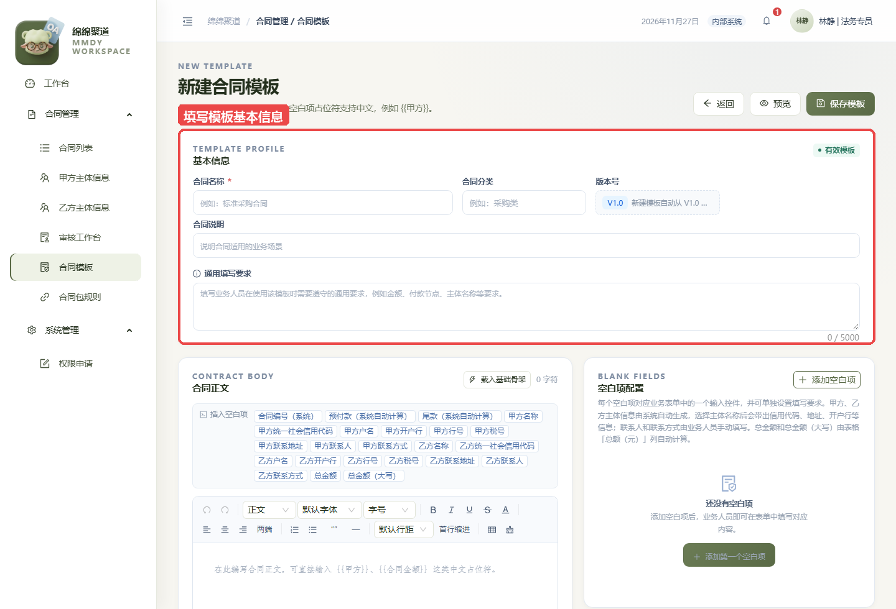
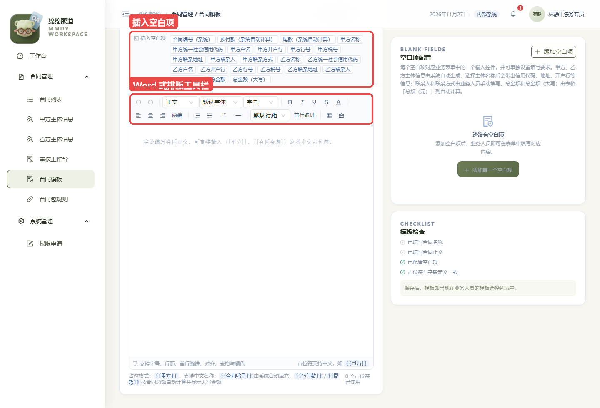
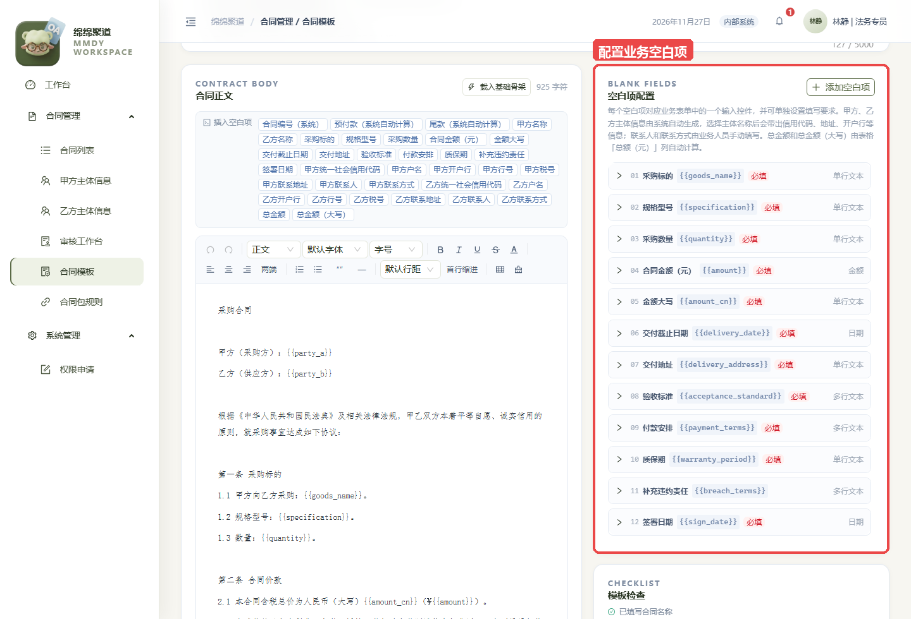
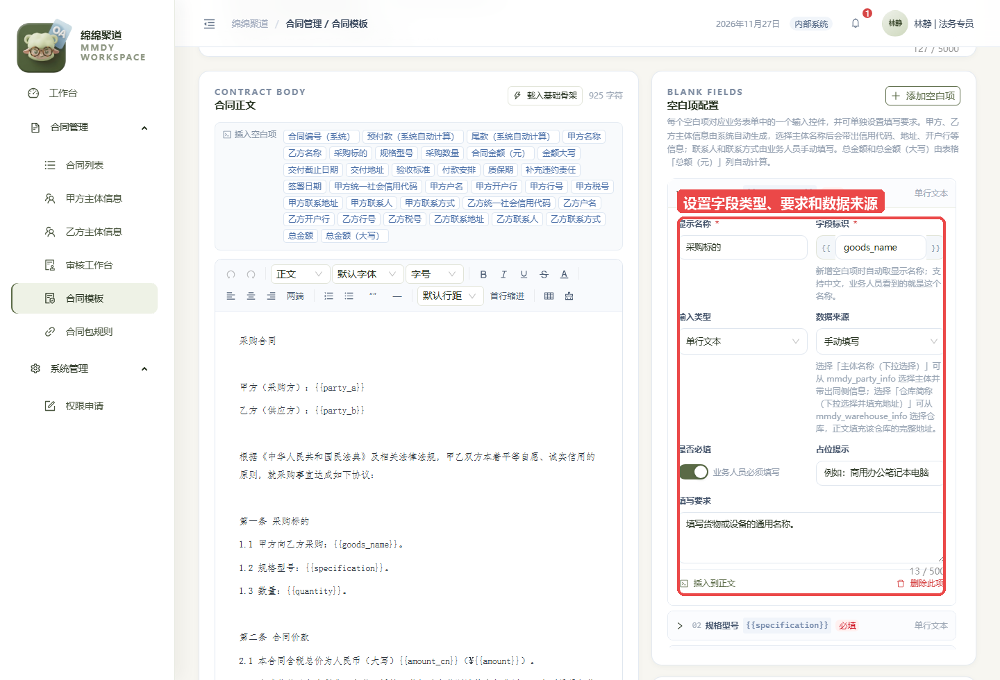
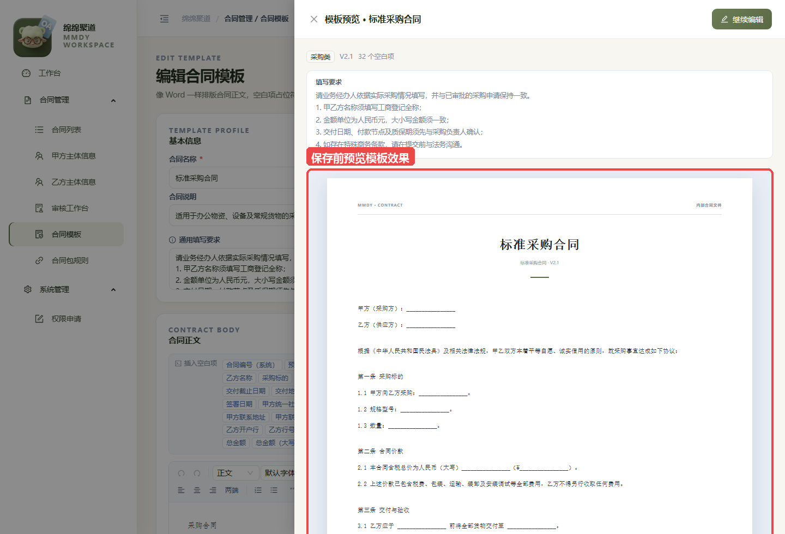
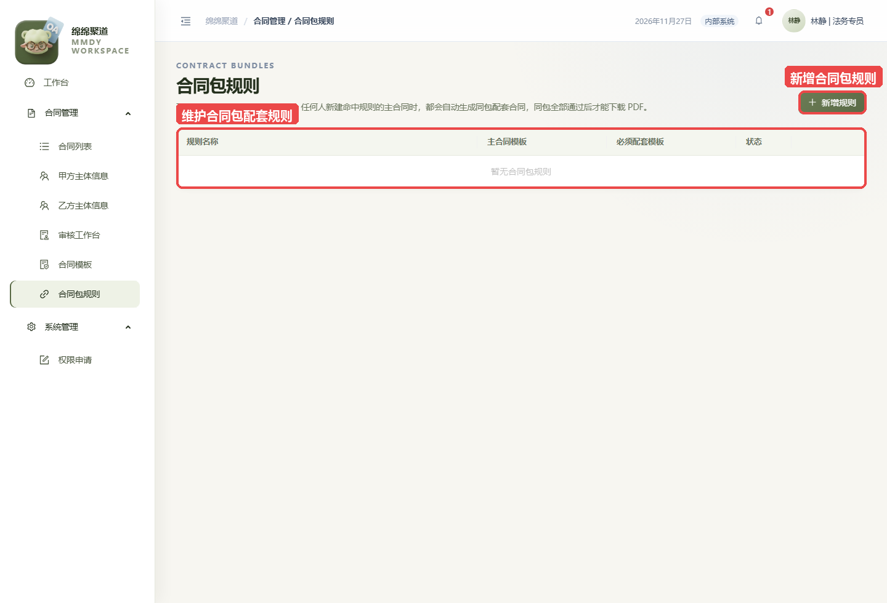

# 绵绵聚道 · 新建合同模板操作教程（法务版）

> 适用对象：法务人员  
> 权限前提：法务账号已开通全部合同管理模块权限，可使用合同列表、主体信息、审核工作台、合同模板和合同包规则。

## 一、模板管理的目标

合同模板是业务人员起草合同的基础。一个规范模板应当做到：

1. 正文结构清晰，条款完整；
2. 需要业务填写的内容用空白项占位；
3. 每个空白项有明确的类型、填写要求和校验规则；
4. 甲乙方、金额、表格合计等可自动获取的内容由系统自动处理；
5. 模板保存后，业务人员可以稳定选择和复用。

模板更新不会改变已经创建的历史合同，历史合同会保留创建时的正文与字段快照。

## 二、进入合同模板库

从左侧菜单进入「合同管理 → 合同模板」。

页面右上角提供以下入口：

- **阅读教程**：打开本教程；
- **上传 Word / PDF**：从现有文档生成模板草稿；
- **新建模板**：从空白模板开始编辑。


模板库支持：

- 查看有效模板、已归档模板、空白项总数和使用次数；
- 按模板名称或分类搜索；
- 预览模板；
- 编辑模板；
- 归档模板；
- 永久删除已归档模板。

> **重点：** 日常下线模板请使用“归档”。归档后业务人员不能再用该模板新建合同，但历史合同不受影响。

## 三、选择新建方式

### 1. 空白新建

点击「新建模板」，进入模板编辑器。

适合：

- 新制定标准合同；
- 需要重新排版；
- 需要精细配置字段和校验规则。

### 2. 从 Word / PDF 导入

点击「上传 Word / PDF」，选择文件后生成模板草稿。

导入后请重点核对：

- 标题和正文是否完整；
- 表格结构是否保留；
- 中文占位符是否识别正确；
- 空白项类型和填写要求是否合适；
- 页眉页脚、图片、复杂图形是否丢失。

> **注意：** 导入只是生成草稿，必须人工核对并保存后才进入模板库。

## 四、填写模板基本信息



### 1. 合同名称

填写便于业务识别的模板名称，例如：

- 标准采购合同；
- 技术服务合同；
- 双向保密协议（NDA）。

### 2. 合同分类

合同分类支持两种方式：

- 从下拉选项选择已有分类；
- 直接输入新分类。

新输入的分类会随模板保存到数据库，并自动进入后续分类选项。

需要特别区分：

- **普通分类**：如采购类、服务类、保密类、通用，会显示在业务人员的新建合同模板列表中；
- **通用类**：只作为合同包配套模板使用，不会直接出现在普通新建合同列表中。

> **重点：** 如果模板是某个主合同的配套附件，请把分类设为「通用类」。

### 3. 版本号

新建模板自动从 `V1.0` 开始。

以下情况会自动升级小版本：

- 合同正文发生变化；
- 空白项结构发生变化。

仅修改名称、分类、说明等基础信息时，不自动升级版本。

### 4. 合同说明

说明该模板适用的业务场景，例如：

> 适用于办公物资、设备及常规货物的采购，覆盖交付、验收、付款与质保条款。

### 5. 通用填写要求

填写业务人员在使用模板时必须遵守的通用要求，例如：

- 甲乙方名称须填写工商登记全称；
- 金额大小写须一致；
- 付款节点须与交付验收绑定；
- 特殊条款须提前与法务确认。

> **建议：** 把高风险、容易填写错误的要求写在通用填写要求中，便于业务人员提交前自查。

## 五、编辑合同正文



正文编辑器提供接近 Word 的排版能力：

- 撤销、重做；
- 正文、标题级别；
- 字体、字号；
- 加粗、斜体、下划线、删除线；
- 字体颜色；
- 左对齐、居中、右对齐、两端对齐；
- 有序列表、无序列表；
- 引用；
- 分隔线；
- 行距；
- 首行缩进；
- 插入和编辑表格。

### 1. 使用中文占位符

需要业务填写的位置使用双花括号占位符，例如：

```text
甲方（采购方）：{{甲方}}
乙方（供应方）：{{乙方}}
合同金额：{{合同金额}}
签署日期：{{签署日期}}
```

字段标识支持中文，不要求使用英文变量名。

### 2. 插入空白项

在正文编辑器上方点击「插入空白项」，选择对应字段即可插入。

也可以直接在正文中输入 `{{字段标识}}`。

> **重点：** 正文中使用了什么占位符，就必须在右侧配置同名空白项；否则保存时会提示未配置。

### 3. 系统占位符

以下占位符由系统自动处理，不需要手工配置字段：

- `{{合同编号}}`：保存合同时自动生成；
- `{{预付款}}`：按合同总额自动计算 30% 并以大写展示；
- `{{尾款}}`：按合同总额自动计算 70% 并以大写展示；
- `{{总金额}}`：由表格「总额（元）」列自动合计；
- `{{总金额大写}}`：根据总金额自动生成人民币大写。

### 4. 表格排版

如果合同包含采购清单、服务明细等表格，请在正文编辑器中插入表格。

推荐表头：

| 序号 | 名称 | 规格型号 | 数量 | 单价（元） | 总额（元） |
| --- | --- | --- | --- | --- | --- |
| 1 | 示例货物 | 示例规格 | 2 | 100.00 | 200.00 |

系统会自动处理：

- 序号自动生成；
- 单行总额 = 数量 × 单价；
- 表格合计行按所有明细行累加；
- 总金额和总金额大写自动计算。

> **注意：** 金额合计依赖表头名称「总额（元）」，请保持该列名称一致。

## 六、配置空白项



右侧「空白项配置」用于定义业务人员需要填写的内容。

### 1. 系统生成字段

系统会自动提供以下字段，不需要手动添加到空白项列表：

- 甲方主体名称、信用代码、户名、开户行、行号、税号、地址；
- 乙方主体名称、信用代码、户名、开户行、行号、税号、地址；
- 甲方联系人、甲方联系方式；
- 乙方联系人、乙方联系方式；
- 总金额、总金额（大写）。

这些字段可以通过正文上方的「插入空白项」工具直接插入正文。

其中：

- 甲乙方主体名称从主体库下拉选择；
- 信用代码、开户行、税号、地址等由主体库自动带出；
- 联系人和联系方式由业务人员手动填写；
- 总金额、总金额大写由表格自动计算。

### 2. 添加自定义空白项

点击「添加空白项」创建业务字段。

每个字段可配置以下内容：



- **显示名称**：业务人员看到的名称，例如“采购标的”；
- **字段标识**：正文占位符名称，默认与显示名称一致，支持中文；
- **输入类型**：
  - 单行文本；
  - 多行文本；
  - 日期；
  - 数字；
  - 金额；
  - 下拉选项。
- **数据来源**：
  - 手动填写；
  - 甲方主体；
  - 乙方主体；
  - 仓库信息。
- **是否必填**：新建空白项默认必填，可改为选填；
- **占位提示**：输入框内的示例文字；
- **下拉选项**：输入类型为下拉选项时配置；
- **填写要求**：针对该字段的具体填写说明。

### 3. 数据来源说明

- 选择甲方/乙方主体名称后，同侧信用代码、地址、开户行等信息自动带出；
- 联系人和联系方式不从主体库带出，由业务人员手动填写；
- 选择仓库简称后，正文可自动填充仓库完整地址；
- 金额字段最多两位小数；
- 数字字段只允许输入数字；
- 日期字段使用日期选择器；
- 下拉字段只能选择已配置选项。

### 4. 哪些字段会要求业务填写

业务人员填写合同时，只会看到模板正文中实际使用到的占位符。

如果字段未在正文中使用，业务人员不需要填写。

> **建议：** 模板保存前检查所有应出现的内容是否已经插入正文，避免业务人员看不到关键字段。

## 七、预览模板



点击页面右上角「预览」，可以查看模板的最终排版效果。

建议重点检查：

- 标题、条款编号是否连续；
- 甲乙方、金额、日期等占位符位置是否正确；
- 表格列宽是否合理；
- 合计行和金额大写是否正常；
- 是否还有错别字或不适用条款；
- 分页后页眉页脚是否正常。

## 八、保存模板

完成正文、字段和填写要求后，点击右上角「保存模板」。

保存前系统会检查：

- 合同名称不能为空；
- 合同分类不能为空；
- 合同正文不能为空；
- 每个空白项必须有显示名称；
- 字段标识不能重复；
- 正文使用的占位符必须有对应字段；
- 不能把系统占位符配置为业务字段。

保存成功后：

- 模板进入合同模板库；
- 业务人员可在新建合同时选择该模板；
- 模板版本按规则自动升级；
- 后续修改不会影响已创建的历史合同。

## 九、合同包规则

合同包用于“主合同 + 通用类配套合同”必须同时签署的场景。



### 1. 先创建通用类模板

新建一个配套模板，把合同分类设置为「通用类」。

通用类模板不会出现在普通新建合同模板列表中。

### 2. 配置合同包规则

进入「合同管理 → 合同包规则」，点击「新增规则」：

- 主合同模板：选择非通用类模板；
- 必须配套模板：选择通用类模板；
- 启用规则。

规则启用后，任何人员新建命中该主合同模板的合同时，系统都会要求同时填写配套通用合同。

### 3. 合同包行为

- 首次保存主合同时，系统检查同主体编号的通用合同是否存在；
- 如果不存在，保存主合同并自动创建同编码通用合同；
- 系统会跳转到通用合同编辑页，提示先填写并保存；
- 合同包列表名称显示为「主合同名称·通用合同名称」；
- 通用合同不在正文中显示独立合同编号；
- 提交审核时，包内所有合同均需填写完整；
- 删除包内任一文件时，会同时删除主合同和配套通用合同；
- 包内全部合同审核通过后才能下载 PDF。

> **重点：** 配套模板必须分类为「通用类」，否则规则不会触发。

## 十、模板归档和删除

### 归档

模板不再使用时，点击模板卡片上的「归档」。

归档后：

- 业务人员不能再选择该模板新建合同；
- 已创建的历史合同不受影响；
- 模板仍可在“已归档”筛选中查看。

### 永久删除

只有已归档模板可以永久删除。

删除后：

- 模板从模板库移除；
- 历史合同仍保留模板快照；
- 不可恢复，请谨慎操作。

## 十一、上线前检查清单

保存模板前建议逐项确认：

- [ ] 合同名称、分类、说明完整；
- [ ] 通用填写要求已填写；
- [ ] 正文条款结构完整；
- [ ] 所有业务填写位置已插入占位符；
- [ ] 占位符与字段标识一致；
- [ ] 每个字段类型正确；
- [ ] 必填项和填写要求明确；
- [ ] 甲乙方主体、仓库等数据来源配置正确；
- [ ] 表格包含正确的「总额（元）」列；
- [ ] 总金额和总金额大写显示正常；
- [ ] 预览排版符合正式合同要求；
- [ ] 如为合同包配套模板，分类已设为「通用类」；
- [ ] 合同包规则已绑定并启用。

## 十二、常见问题

### 1. 业务人员看不到新模板

- 确认模板状态为“有效”；
- 确认分类不是「通用类」；
- 确认业务人员已开通合同列表权限；
- 确认模板已保存成功。

### 2. 保存时提示“正文使用了未定义的空白项”

正文中的占位符没有对应字段。

处理方法：

- 在右侧添加同名空白项；或
- 修改正文占位符名称，使其与已有字段一致。

### 3. 总金额没有自动计算

请检查正文表格：

- 是否包含「总额（元）」列；
- 表头名称是否完全一致；
- 是否存在有效的数据行。

### 4. 主体信息没有自动带出

- 确认字段数据来源选择为甲方主体或乙方主体；
- 确认主体库中存在该主体；
- 主体名称字段需要使用下拉选择。

### 5. 通用类模板为什么不出现在新建合同中

这是正常行为。通用类模板只能通过合同包规则绑定到主合同，不能单独发起。

### 6. 修改模板会影响历史合同吗

不会。历史合同保存了创建时的模板正文和字段快照。

---

如模板结构与公司现行制度不一致，请先完成法务内部评审，再发布为有效模板。
